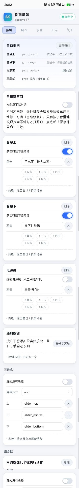
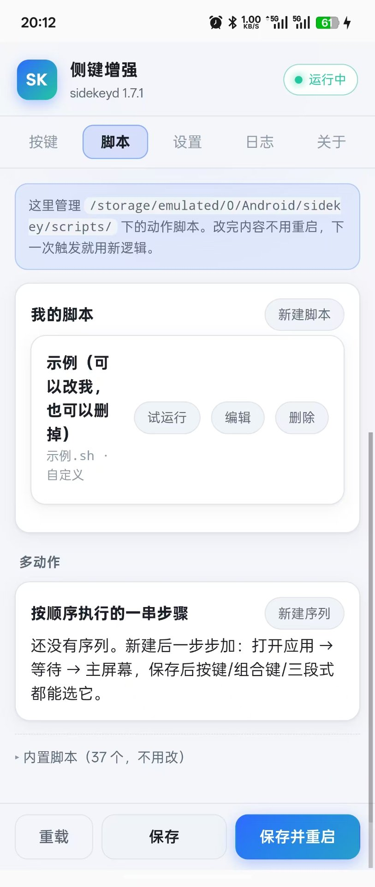
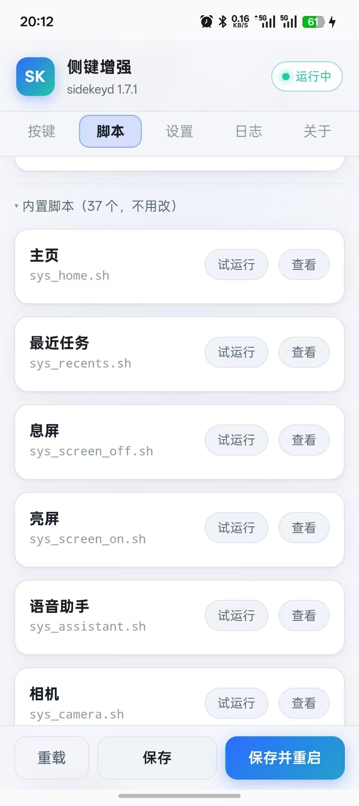
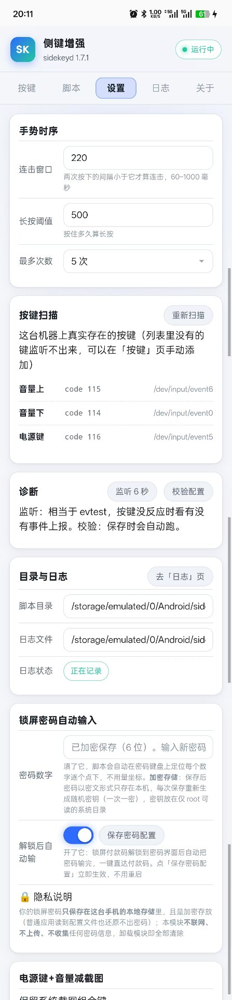
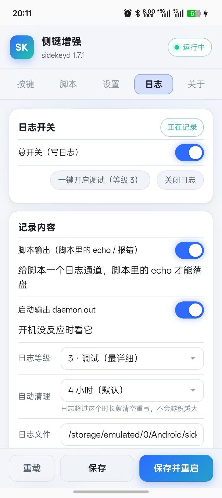
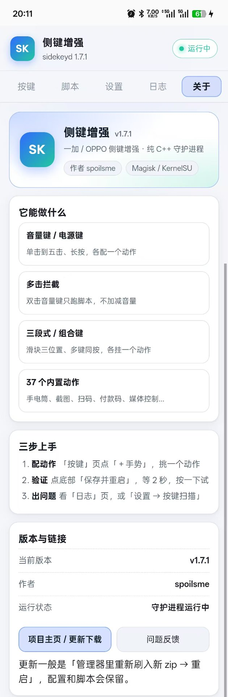

# SideKey — 一加 / ColorOS 侧键增强模块

   

纯 C++ 实现的 KernelSU / Magisk / APatch 模块：把电源键、音量键、三段式静音开关变成
可编程快捷键，支持多击、长按、组合键，内置 37 个常用动作，全部配置在 WebUI 里点几下就能完成。

- 作者：spoilsme
- 平台：arm64，一加 / OPPO / realme（ColorOS 15 / 16 实测），其他机型理论可用（自动识别按键）
- 本仓库只提供**安装包与说明**，下载请到 [Releases](https://github.com/spoilsme/SideKey/releases)

## 界面预览

| 按键 · 手势绑定 | 脚本 · 我的脚本 / 多动作 | 脚本 · 37 个内置动作 |
| --- | --- | --- |
|  |  |  |

| 设置 · 手势时序 / 密码 | 日志 · 开关与自动清理 | 关于 · 版本与链接 |
| --- | --- | --- |
|  |  |  |

## 项目特色

- **零门槛配置**：打开 WebUI 自动识别这台机器的实体按键和三段式开关，点「＋手势」挑一个动作、点「保存并重启」，2 秒生效，全程不用碰命令行
- **纯 C++ 守护进程**：没有 Java / Xposed / LSPosed 依赖，开机即用，不注入任何应用，兼容所有 root 管理器
- **真·多击拦截**：通过 uinput 独占按键设备，双击音量键只跑你的脚本，不会顺带加减音量（自动检测支持情况）
- **组合键自动识别**：只列出这台机器真实存在的按键，耳机线控、相机键这些不存在的键不会出现
- **电源键友好**：默认叠加模式，息屏 / 亮屏 / 关机菜单全部保留，双击脚本只是额外多跑一次；「电源键 + 音量减」截图组合键可保持可用
- **锁屏自动化**：锁屏直接拉起微信付款码并自动解锁到密码键盘，全程约 3 秒；密码加密存储、仅存本机
- **手电筒满功率**：开关走 OPlus 官方服务（控制中心始终正常），点亮后自动拉满亮度，实测开灯约 1.7 秒
- **脚本热更新**：自己的脚本放手机目录里，改完即时生效不用重启；WebUI 里还能一键试运行
- **隐私干净**：不收集、不上传任何数据；唯一的联网操作是拉取一个几百字节的版本号 JSON（24 小时才拉一次，不携带任何设备信息），卸载即全部清除

## 下载

| 版本 | 说明 |
| --- | --- |
| **v1.7.1**（最新） | 手电筒改用官方服务开关，控制中心不再失灵；修复手电筒一键复位 |
| v1.7.0 及更早 | 历史版本都在 [Releases](https://github.com/spoilsme/SideKey/releases) 页面 |

到 [Releases](https://github.com/spoilsme/SideKey/releases) 下载 `sidekey-vX.Y.Z.zip`，直接刷入即可。

## 安装

1. 把 `sidekey-v1.7.1.zip` 刷进 KernelSU（或 Magisk / APatch），**重启**。
   - 兼容 KernelSU / KSU Next、Magisk 稳定版 / Beta / Canary、Magisk Delta / Alpha、
     APatch、狐狸面具（Fox Magisk Module Manager）等所有主流 root 管理器。
   - v1.7.0 起包内补齐了标准 `META-INF/com/google/android/update-binary`（Magisk
     官方安装脚本）：之前缺失它会导致 Magisk 系安装器报「Unzip error」刷入失败
     （KernelSU 不依赖它所以之前能装）。
2. 打开模块的 WebUI，按键页会自动识别本机的按键和三段式开关。
3. 点任意手势行挑一个动作，底部「保存并重启」生效（守护进程重启约 2 秒）。

升级 = 管理器里刷入新 zip 再重启，配置和脚本都会保留。

### 模块内更新（v2.0.0 起）

包内的 `module.prop` 带了 `updateJson` 字段，所以 **root 管理器的模块列表会自己检查新版**：
有新版本时「侧键增强」那一行会直接出现「更新」按钮，点一下就能下载新 zip，
不用自己去 Releases 找。KernelSU / KSU Next、Magisk、APatch、MMRL 都支持这套机制。

- 检查用的是仓库根目录的 [`update.json`](update.json)，由发布脚本在每次发版后刷新；
- 走 jsDelivr 的 **fastly 节点**（`fastly.jsdelivr.net`）：实测国内直连可用，`cdn.jsdelivr.net` 和 `raw.githubusercontent.com` 都会被重置；
- WebUI 的「简介」页也有一份：进页面自动查（24 小时内只查一次），`有新版本` 会显示成彩色徽标，点它下载；
- 管理器拉不到更新时不影响模块本身，手动刷 zip 一样升级；
- ⚠️ **从 v1.7.x 及更早版本升上来的第一次仍需手动刷**：老版本的 `module.prop` 里没有 `updateJson`，
  管理器无从检查；装过一次 v2.0.0 之后，以后每次新版都会自动提示。

## 内置动作库

WebUI「脚本」页可查看全部内置脚本（只读）和试运行；自己写的脚本放
`/storage/emulated/0/Android/sidekey/scripts/`，改完即时生效不用重启。

**ColorOS 快捷**：

| 脚本 | 功能 | 说明 |
| --- | --- | --- |
| `sys_home.sh` / `sys_back.sh` | 主屏 / 返回 | |
| `sys_recents.sh` | 最近任务 | |
| `sys_screen_off.sh` / `sys_screen_on.sh` | 息屏 / 亮屏 | |
| `sys_power_menu.sh` | 电源菜单 | |
| `sys_notification.sh` | 下拉通知栏 | |
| `sys_qs.sh` | 展开快捷设置 | |
| `sys_split.sh` | 分屏 | |
| `sys_screenshot.sh` | 截图 | |
| `sys_assistant.sh` / `sys_camera.sh` | 语音助手 / 相机 | |
| `cos_ocr.sh` | 文字识别 | |
| `cos_screenshot_area.sh` | 区域截图 | |
| `cos_torch.sh` | 手电筒（最大亮度） | **v1.7.1**：开关完全沿用 OPlus 官方服务（判断 `flashlight_enabled` → ACTION_OPEN/CLOSE + 同步两个 settings 值，**全程不碰 `switch_*` 电源闸**），点亮后再把 `led:torch_*` 拉到 `max_brightness` 得到满功率。实测：开灯约 1.7 秒、关灯约 0.5 秒，**控制中心手电筒开关始终正常**。若哪天失灵，WebUI「设置」页点【修复手电筒】（或 `TORCH_REPAIR=1 cos_torch.sh`）约 10 秒恢复，不用重启手机。日志 `torch.log` |
| `cos_torch_sys.sh` | 手电筒（系统亮度·原版） | 走 OPlus 官方手势服务，与相机 HAL 完全兼容 |
| `cos_bypass.sh` | 游戏免打扰 | |
| `cos_nfc.sh` | NFC 开关 | |
| `cos_ringer.sh` | 铃声 响铃→震动→静音 | 读当前模式 → 切下一个 → 回读确认，带切换提示；日志 `ringer.log` |

**媒体**：`media_play.sh`（播放 / 暂停）、`media_next.sh` / `media_prev.sh`（切曲）、
`slider_volume_up.sh` / `slider_volume_down.sh`（音量加减）。

**微信 / 支付宝**：

| 脚本 | 功能 | 说明 |
| --- | --- | --- |
| `wx_scan.sh` | 微信扫一扫 | |
| `wx_pay.sh` | 微信付款码（亮屏版） | 直接拉起付款码界面 |
| `wx_pay_lock.sh` | 付款码（锁屏自动解锁） | 亮屏 → 菜单键抬起锁屏 → 底部上滑出密码键盘（ColorOS 实测配方）；conf 写 `chain=1` 可自动输密码（v1.6.9 全程约 3 秒） |
| `wx_password.sh` | 自动输入密码 | 自动定位键盘逐位点按；v1.6.9 起键盘坐标缓存（首次校准后免抓屏）、密码加密存储。`WX_KEYPAD_REFRESH=1` 强制重新校准 |
| `ali_scan.sh` / `ali_pay.sh` | 支付宝扫一扫 / 付款码 | |
| `ali_trip.sh` | 支付宝出行码 | |

**已移除**：`slider_torch.sh`、`tool_flashlight_toggle.sh`、`wx_trip.sh`
（微信已拦截外部跳小程序的 scheme）。

## 锁屏密码自动输入（WebUI 配置）

「设置」页 →「锁屏密码自动输入」卡：填密码数字、可选打开「解锁后自动输」，
点保存立即生效。

**隐私与安全（v1.6.9 起）：**

- 密码**加密存储**：conf 里只有密文 `enc=`，采用一次一密（每次保存重新生成随机密钥）；
- 密钥单独放在 `/data/adb/sidekey/.pkey`（权限 600，普通应用无法读取）；
- 密码**仅保存在本机**，模块**不联网、不上传、不收集**任何密码信息，卸载模块即全部清除。

## 故障排查

- 守护进程没起来：看 WebUI「日志」页 → daemon.out 和 sidekeyd.log
- 手电筒点不亮（控制中心）：WebUI「设置」页点【修复手电筒】（= `TORCH_REPAIR=1 cos_torch.sh`），约 10 秒恢复，**不用重启手机**
- 铃声切换不对：看 `ringer.log`，把日志发到 Issues
- 多击拦截不生效：设置页「按键扫描」确认设备和 uinput 状态
- 刷入失败：确认 root 管理器版本，附上安装日志提到 Issues

## 目录说明（安装后）

```
/data/adb/modules/sidekey/            模块本体（勿手改）
/data/adb/sidekey/                    运行数据：日志、密钥
/storage/emulated/0/Android/sidekey/  用户脚本（改完即时生效）
```

## 反馈

问题与建议请开 [Issues](https://github.com/spoilsme/SideKey/issues)，附机型、系统版本、复现步骤和相关日志。

## 许可

本项目以 [MIT License](LICENSE) 开源。使用本模块产生的任何后果由使用者自行承担。
